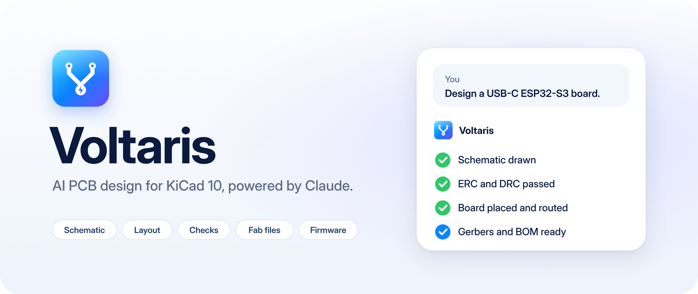
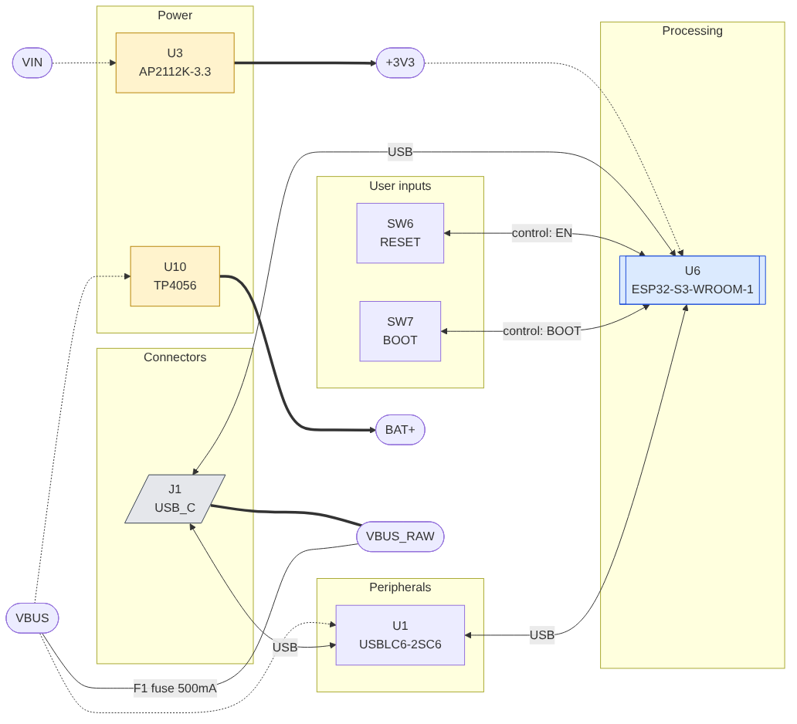
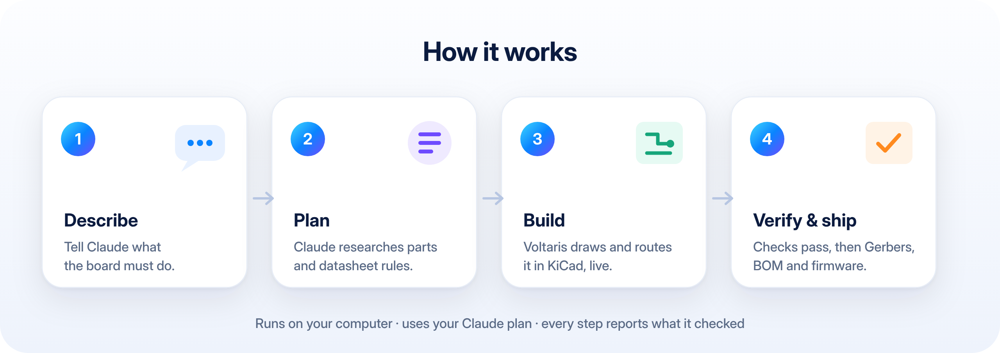

<a name="top"></a>

<div align="center">



<br/>

[](LICENSE)
[](#-install)
[](#-install)
[](docs/TOOLS.md)

### Describe the board. Claude designs it in KiCad — and checks its own work.

[Install](#-install) · [Features](#-features) · [Examples](#-try-it) · [How it works](#-how-it-works) · [Docs](docs/SETUP.md)

</div>

<br/>

## ⚡ Why Voltaris

Voltaris connects **Claude** to **KiCad 10** on your computer. You explain what the board must
do; Claude researches parts, draws the schematic, places and routes the PCB, runs every check,
and hands you files a fab can build.

<table>
<tr>
<td width="25%" align="center"><h3>🆓</h3><b>Your Claude plan</b><br/><sub>No API key, no extra subscription</sub></td>
<td width="25%" align="center"><h3>🏠</h3><b>Runs locally</b><br/><sub>Designs never leave your computer</sub></td>
<td width="25%" align="center"><h3>🧪</h3><b>Checked, not guessed</b><br/><sub>Every stage reports evidence</sub></td>
<td width="25%" align="center"><h3>🏭</h3><b>Fab-ready</b><br/><sub>Gerbers, BOM and placement files</sub></td>
</tr>
</table>

## ✨ Features

**257 tools across 33 on-demand toolsets.** Guided by 16 expert skills.

| | Design | | Verify | | Deliver |
|:-:|---|:-:|---|:-:|---|
| 🧠 | Gated pro workflow | ✅ | Your rules as automatic checks | 🏭 | Gerbers, drill, BOM, pick-and-place |
| 🛣️ | **One-call autorouter** (`route_board`): coupled, length-matched USB pairs and fine-pitch fanout | 🎨 | **One-call polish**: pin labels, tidy designators, pours, stitching | 🔁 | Freerouting with cleanup |
| 📍 | **Smart placement** (`smart_place`) that shortens a hand layout's connections by 10–20 % | 🩺 | **Layout + EMC audit** with engineering and beauty grades | 🧭 | Pro layout and board-craft skills |
| 📄 | Datasheet reader with page citations | 🔎 | ERC, DRC and design review | 🔌 | Firmware pin maps + bring-up code |
| 🧱 | Verified circuit library | 👁️ | 3D visual review | 📐 | 3D-printable enclosure |
| ⚙️ | Trace, impedance and power calculators | 🔬 | Circuit simulation | 📦 | LCSC part import |
| 🗺️ | Block diagrams from the netlist | 📏 | Length and skew checks | 🕰️ | Snapshots, diffs and restore |

**Chips with firmware support:** ESP32 · ESP32-S3 · ESP32-C3 · ESP32-C6 · RP2040 · RP2350 · STM32 · nRF52

<div align="center">
<br/>

<br/><sub>A block diagram Voltaris drew from a real schematic: power tree, USB, protection and buttons.</sub>
</div>

## 🚀 Install

**Step 1 — Install Voltaris in KiCad**

1. Download `voltaris-pcm-v<version>-<platform>.zip` from [Releases](https://github.com/NextBuilder/Voltaris/releases).
2. In KiCad 10, open **Plugin and Content Manager → Install from File**, then restart KiCad.
3. Turn on **Preferences → Plugins → Enable KiCad API**, then restart KiCad.

**Step 2 — Connect Claude**

| You use | Do this |
|---|---|
| **Claude app (Cowork)** | Customize → Plugins → Add → **Add marketplace** → `https://github.com/NextBuilder/Voltaris` → install **Voltaris** |
| **Claude Code** | `/plugin install voltaris --marketplace NextBuilder/Voltaris` |
| **Claude Desktop** | Double-click `voltaris-<version>-win32.mcpb` from [Releases](https://github.com/NextBuilder/Voltaris/releases) → **Install** |

> [!NOTE]
> The plugin needs **Node.js 18+**. KiCad tools run in Cowork and Claude Code; in plain chat
> only the design skills load, because chat can't start programs on your computer.

## 💬 Try it

```text
Design a USB-C powered ESP32-S3 board with an SHT30 sensor and a Li-ion charger.
Every I2C line needs exactly one pull-up — check that from now on.
What does the TPS563200 datasheet say about layout?
Snapshot the board, autoroute it, then show me what changed.
Generate the Gerbers, BOM and placement files for JLCPCB.
```

## 🧭 How it works

<div align="center">

</div>

- **PCB edits are live** through KiCad's official API, with KiCad's own undo.
- **Schematic edits** use a validated engine with atomic writes, so files never corrupt.
- **Tools load on demand**, so Claude only sees what the current task needs.

## 📚 Documentation

| Guide | |
|---|---|
| [Setup & configuration](docs/SETUP.md) | Manual install, config files, other AI clients |
| [All tools](docs/TOOLS.md) | Every tool, grouped by toolset |
| [Troubleshooting](docs/TROUBLESHOOTING.md) | Fixes for common problems |
| [Developer docs](docs/dev/README.md) | Build from source, architecture, contributing |
| [Privacy](PRIVACY.md) | No accounts, no telemetry — what is sent and when |

## ⚠️ Good to know

AI-designed boards still need a human review and a small first batch. KiCad 10 has no live
schematic API, so schematic edits are file-based; PCB edits are live.

<br/>

<div align="center">

**Made by [Kishan Pratap Singh](https://github.com/NextBuilder) · Next Builder**

[](https://youtube.com/@NextBuilderIO)
[](https://www.instructables.com/member/Next%20Builder%20DIY/)
[](https://hackster.io/NEXTBUILDER)
[](https://instagram.com/next_builder)
[](https://x.com/NEXTBUILDERIO)
[](https://www.linkedin.com/company/nextbuilderio/)

<sub>Licensed under AGPL-3.0 · see <a href="NOTICE.md">NOTICE</a> for credits</sub>

</div>
